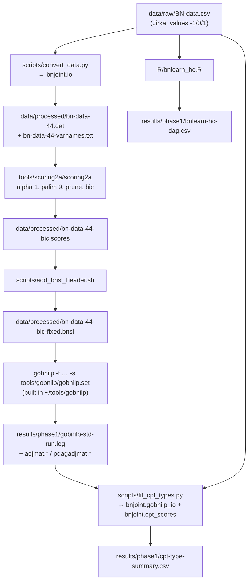

# Architecture: how the pieces connect

This is the map. Each stage has its own guide with the details:
[phase1-pipeline.md](phase1-pipeline.md), [scoring2a.md](scoring2a.md),
[cpt-scoring.md](cpt-scoring.md). The function-level "how" is in the docstrings.

## Data flow of Phase 1 (`make phase1`)

In words: the data is converted to scoring2a's format; scoring2a computes the BIC of every
candidate parent set (assuming STD tables); GOBNILP picks the best-scoring acyclic network
from those scores; the Python code then re-scores each chosen family with STD, MLR and OLR
and picks a type per node (the "two-stage" method of the Kybernetika paper). Separately,
bnlearn's hill-climbing learns the structure the paper used, for comparison.

## Where things live

| Layer | Folder | Rule |
|---|---|---|
| Original data | `data/raw/`, `data/reference/` | Read-only |
| Derived data | `data/processed/` | Rebuilt by `make` |
| Reusable Python | `src/bnjoint/` | All logic; one copy of each formula |
| Entry points | `scripts/` (Python, Bash), `R/` | Thin: parse arguments, call the package, print a summary |
| Other people's programs | `tools/` (source + settings); builds in `~/tools/` | Not edited; binaries not committed |
| Tests | `tests/` | One file per module, plus regression tests on reported numbers |
| Outputs | `results/<experiment>/` | One folder per experiment, with a README |
| Orchestration | `Makefile` | One target per stage |

## Python modules and who uses them

| Module | Used by | Depends on |
|---|---|---|
| `bnjoint.config` | everything | nothing |
| `bnjoint.io` | `convert_data.py`, `fit_cpt_types.py`, tests | `config` |
| `bnjoint.gobnilp_io` | `fit_cpt_types.py`, tests | nothing |
| `bnjoint.cpt_scores` | `fit_cpt_types.py`, tests | `config`, statsmodels |

## Make targets

`make help` lists them. `phase1` (the pipeline above), `test-data24` (GOBNILP smoke test),
`provenance` (Jirka's R conversion check), `scoring2a` (compile), `test`, `lint`, `format`,
`inventory`. Make only re-runs a stage when one of its inputs changed; the dependency list of
each rule is in the `Makefile`, with comments.

## Why it is organized this way

- **Package + thin scripts** (rather than one long script per task): later phases score
  thousands of parent sets with the same STD/MLR/OLR code, so the math must be importable and
  tested, not copy-pasted. Rejected: keeping `fit_cpt_types.py` as one file (couldn't test or
  reuse it).
- **Makefile** (rather than a Bash pipeline script): it records the dependencies, so a changed
  input re-runs exactly the stages after it, and the 15-minute scoring step isn't repeated
  needlessly. Rejected: `run_gobnilp_pipeline.sh` (always re-ran everything, used `cd src`).
- **Editable install** (`pip install -e .`, rather than setting `PYTHONPATH`): `import bnjoint`
  then works from scripts, tests and notebooks without extra setup.
- **GOBNILP outside the repo**: it is someone else's 42 MB git repository; nesting it made a
  broken "submodule" pointer (decision log entry 16).

## How to change common things safely

- **Add a new pipeline stage**: put the logic in a `src/bnjoint/` module with tests, add a thin
  script, add a Make rule with its inputs as prerequisites, write outputs to a new
  `results/<experiment>/` folder with a README.
- **Change a formula**: change it only in `cpt_scores.py`, run `make test`. If
  `test_phase1_regression.py` fails, a reported number changed: that needs a decision log entry
  and a dated correction, not a quiet update.
- **Move a file**: `git mv`, update `config.py`/Makefile paths, update the folder READMEs, run
  `make inventory` and `make test`.
